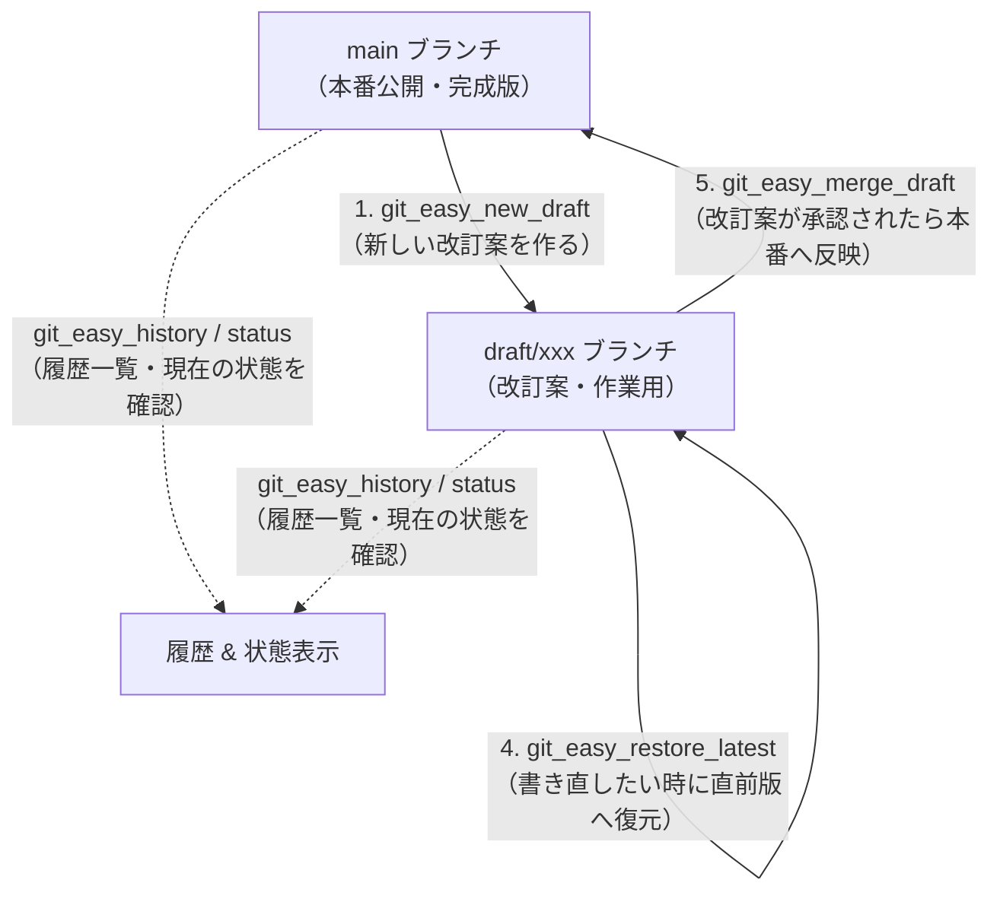

# Git Easy (簡易Gitドキュメント管理プラグイン)

**Git Easy** は、Markdown形式のドキュメント、操作マニュアル、および `SKILL.md` などのスキル・プロンプト定義ファイルを、Gitの複雑なコマンドを意識することなく安全にバージョン管理するための Zee エディタ向けプラグインです。

プログラム開発向けの難解なGit操作（リベース、複雑なコンフリクト解消、ブランチ戦略など）を排除し、**「改訂案（ドラフト）をブランチで執筆し、版（スナップショット）を重ね、過去の版にいつでも戻せて、承認されたら本番に反映（マージ）する」** という執筆者のためのシンプルなワークフローを提供します。

---

## 1. コンセプトと特徴

- **ドキュメント・スキル特化の直感操作**:
  Gitの黒い画面やコマンドラインを一切叩かずに、メニューからワンクリックで版管理が完了します。
- **スマート推測（自動メッセージ・ブランチ命名）**:
  文字入力プロンプトがなくても、選択中のテキストやMarkdownの見出し（`# タイトル`）、日時から自動的にわかりやすいコミットメモやドラフト名を生成します。
- **2段階の管理意識（管理開始 ➔ 版の保存）**:
  バージョン管理を初めて使う人が躓きやすい「Untracked（未管理ファイル）」を意識できるよう、**「バージョン管理開始 (git add)」** と **「今のバージョンを保存 (git commit)」** を明確に区別して扱えます。
- **安心のセーフティガード（本体無改造）**:
  エディタのバッファ内容を誤って消去しないデータ保護設計。Gitリポジトリがないフォルダでも自動で初期化（`git init`）して安全に記録を開始します。
- **.gitignore の自動管理**:
  初期化時に、macOSの `.DS_Store` やエディタのスワップファイル（`*.swp`）、一時ファイルを自動で除外する `.gitignore` を自動生成。さらに不要なファイルは **「バージョン管理から除外する」** で一発追記できます。
- **タイムマシーン（直前版への巻き戻し）**:
  「色々書き直してみたけれど、やっぱり前回の保存状態に戻したい」という場合も、1コマンドで前回の保存版（HEAD）に安全に復元できます。

---

## 2. ドキュメント改訂ワークフロー



### 典型的な利用シナリオ（例: `SKILL.md` やマニュアルの改訂）

1. **改訂作業の開始 (`git_easy_new_draft`)**:
   本番の `main` を直接編集せず、新しい改訂案ブランチ（例: `draft/prompt-tuning`）を作成して切り替えます。
2. **新規文書の管理開始 (`git_easy_add_file`)**:
   新しく作ったファイルがあれば、「バージョン管理開始」で追跡対象に登録します。
3. **執筆と版の記録 (`git_easy_snapshot`)**:
   章の追加やプロンプトの調整が終わるたびにスナップショットを保存します。
4. **試行錯誤と巻き戻し (`git_easy_restore_latest`)**:
   変更案を試してうまく動かなかった場合、即座に前回のセーブポイントに戻せます。
5. **承認と本番反映 (`git_easy_merge_draft`)**:
   レビューや動作確認が完了したら、ドラフトを `main` にワンステップでマージ反映します。

---

## 3. コマンド仕様書

すべてのコマンドは上部メニューバーの **「Plugins」→「Git Easy」**、または Zee のコマンドパレットから実行できます。

| コマンドID | メニュー表示 | 主な機能 | テキスト選択時のスマート挙動 | テキスト未選択時のスマート挙動 |
| :--- | :--- | :--- | :--- | :--- |
| `git_easy_add_file` | **バージョン管理開始**<br>*(Add to Version Control)* | 指定したファイル（または未管理ファイル）をGitの追跡対象（`git add`）に登録します。 | 選択テキストがファイル名ならそのファイルを登録 | 現在変更・作成されたファイルをステージング |
| `git_easy_ignore_file` | **バージョン管理から除外**<br>*(Exclude from Git)* | 対象ファイルを `.gitignore` に追記し、Git追跡から安全に外します。 | 選択テキストのファイル名を除外リストに追加 | 変更中のファイルを除外リストに追加 |
| `git_easy_snapshot` | **今のバージョンを保存**<br>*(Save Snapshot)* | 現在の変更をすべてGitに記録（コミット）します。バッファ内容は完全に保護。 | 選択テキストをコミットメモとして使用<br>*(例: `制約条件を修正`)* | 文書の先頭見出し（`# タイトル`）と現在日時をメモとして自動記録 |
| `git_easy_new_draft` | **新しい改訂案を作る**<br>*(New Draft)* | 現在の作業を自動保存し、作業用の `draft/...` ブランチを作成・チェックアウトします。 | 選択テキストをブランチ名として使用<br>*(例: `v2-update` 選択 → `draft/v2-update`)* | 文書の見出しまたは日時から自動生成<br>*(例: `draft/skill-tuning-1025-0915`)* |
| `git_easy_merge_draft` | **改訂案をメインに反映**<br>*(Merge Draft to Main)* | 作業中のドラフトをコミットし、`main`（または `master`）に切り替えて安全にマージします。 | - | マージ後、最新のファイル内容をバッファに再反映します。 |
| `git_easy_switch_draft` | **メイン ⇔ ドラフト切替**<br>*(Switch Draft / Main)* | `main` と直前のドラフトブランチをワンタッチで相互に切り替えます。 | - | 切り替え前に現在の未保存変更を自動保存するため安全です。 |
| `git_easy_restore_latest` | **直前の保存版に戻す**<br>*(Restore to Last Snapshot)* | 現在の編集内容を破棄し、直近のコミット（HEAD）保存状態にバッファをロールバックします。 | - | 誤った大幅な削除や書き損じを一瞬で取り消せます。 |
| `git_easy_history` | **履歴一覧を確認**<br>*(View History)* | 直近のスナップショット履歴（日時、メモ、コミットID）をMarkdown形式で取得・表示します。 | 選択範囲を履歴ブロックに置換 | 文書末尾に履歴ブロックを挿入（既存ブロックがある場合は最新化） |
| `git_easy_status` | **現在の状態を確認**<br>*(Show Status)* | 現在のブランチ、直近の版、未保存の変更ファイル数をMarkdownノート形式で表示します。 | - | 文書先頭にステータスブロックを挿入（既存ブロックがある場合は最新化） |

---

## 4. 自動生成・保護される `.gitignore`（クロスプラットフォーム対応）

リポジトリ初期化時（`git init`）または初回操作時に、リポジトリのルートに以下のテンプレートで `.gitignore` が自動生成されます。Macで作成したリポジトリをWindowsで開いた場合や、その逆でも、OSのゴミファイルが混入しないよう**全プラットフォーム（macOS / Windows / Linux）の必須パターンを最初から網羅**します。

### 既存の `.gitignore` とのインテリジェント・マージ
もし**既にプロジェクトに `.gitignore` が存在する場合でも、元からある行や設定は一切削除せずそのまま残します**。
不足しているOS除外パターンのみを末尾に追記し、**既に記述されている項目（例: `.DS_Store`）があれば、Git Easyの追記ブロック内では `# .DS_Store (already in .gitignore)` のように自動でコメントアウト**して二重登録を防ぎます。

```gitignore
# ==============================================================================
# Protected by Git Easy (Cross-Platform OS & Editor Ignores)
# ==============================================================================
# macOS
# .DS_Store (already in .gitignore)  <-- 既に存在する場合はコメントアウト
.DS_Store?
._*
.Spotlight-V100
.Trashes
.AppleDouble
.LSOverride

# Windows
Thumbs.db
Thumbs.db:encryptable
ehthumbs.db
ehthumbs_vista.db
desktop.ini
$RECYCLE.BIN/

# Linux & Temporary Files
*~
.fuse_hidden*
.directory
*.swp
*.swo
*.tmp
*.bak
.zee/
```

さらに、誤って既にGitの追跡対象になってしまっていた `.DS_Store` や `Thumbs.db` があれば、**自動でインデックスから登録解除（`git rm --cached`）してクリーンアップ**します。手動で除外したいファイルがあれば `git_easy_ignore_file` を実行するだけで、この `.gitignore` の末尾に自動追記されます。

---

## 5. 履歴・ステータスブロックの表示例

`git_easy_history` または `git_easy_status` を実行すると、文書内に以下のような可視化ブロックが挿入されます。このブロックは再実行時に自動で最新情報に更新されます。

### 履歴表示 (`git_easy_history`)
```markdown
<!-- BEGIN Git Easy History -->
### 📜 Version History (Branch: `draft/prompt-tuning`)
* 2026-10-25 09:30 [3fa8b12] Snapshot: [SKILL.md] 制約条件の明確化 (2026-10-25 09:30)
* 2026-10-25 09:15 [8c4e091] Snapshot: [SKILL.md] 2026-10-25 09:15
* 2026-10-25 08:30 [1d2e3f4] Snapshot: 初期作成
<!-- END Git Easy History -->
```

### 状態表示 (`git_easy_status`)
```markdown
<!-- BEGIN Git Easy Status -->
> [!NOTE]
> **Git Easy Status**
> - **Current Branch**: `draft/prompt-tuning`
> - **Last Snapshot**: [3fa8b12] Snapshot: [SKILL.md] (5 minutes ago)
> - **Working Tree**: Clean (all saved)
<!-- END Git Easy Status -->
```

---

## 6. インストール方法

### A. Zee プラグインフォルダへ直接配置する場合
プラグインディレクトリを Zee の設定フォルダにコピー（またはシンボリックリンク）します：

- **macOS / Linux**:
  ```bash
  mkdir -p ~/.config/zee/plugins/git-easy
  cp -r ~/dev/zee-plugins/plugins/git-easy/* ~/.config/zee/plugins/git-easy/
  # またはシンボリックリンク
  ln -sfn ~/dev/zee-plugins/plugins/git-easy ~/.config/zee/plugins/git-easy
  ```
- **Windows**:
  ```powershell
  mkdir "$env:APPDATA\zee\plugins\git-easy"
  Copy-Item -Recurse ~/dev/zee-plugins/plugins/git-easy/* "$env:APPDATA\zee\plugins\git-easy\"
  ```

Zee を再起動、または `:plugin reload` を実行すると、上部メニューの **「Plugins」** に **「Git Easy」** が追加されます。

### B. レジストリ（`zee-plugins`）からインストールする場合
Zee のプラグインマネージャー（メニュー: `Plugins -> Manage Plugins...`）を開き、Registryタブから `Git Easy` を検索して **「Install」** を押すだけで自動導入されます。

---

## 7. ライセンス

MIT License
